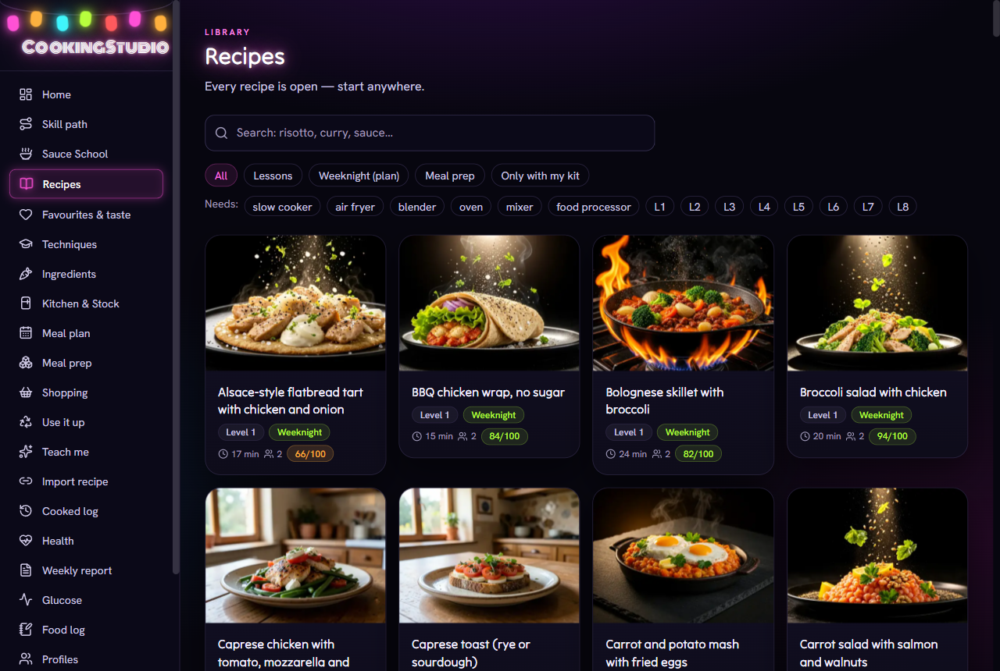
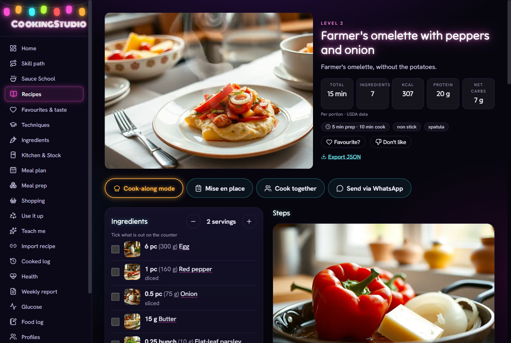
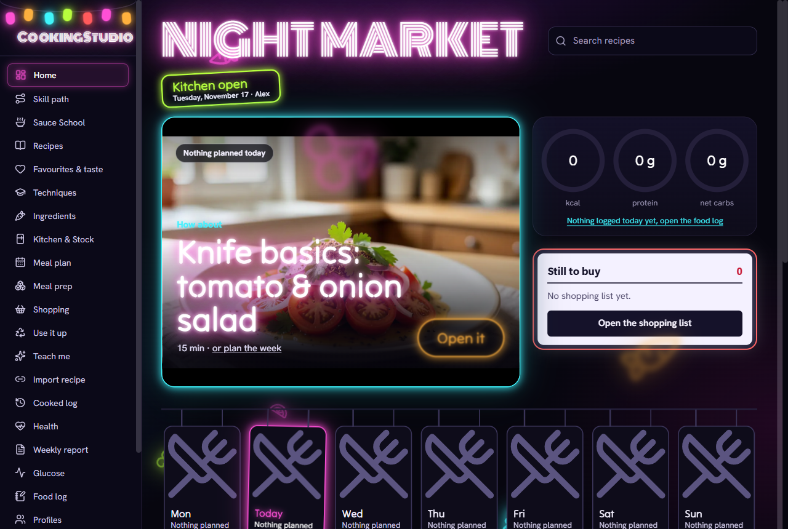
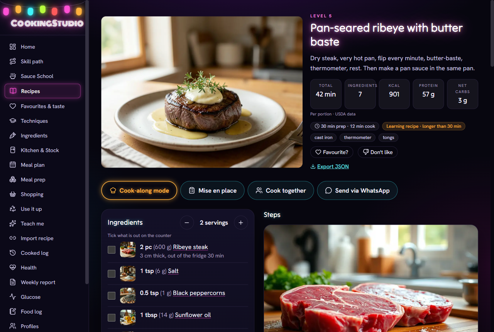

# CookingStudio

A self-hosted cooking app for a two-person household that wants to learn to cook by doing. It walks you through recipes step by step, teaches the classic sauces, plans the week against each person's diet rules, writes the shopping list, keeps track of what is in the fridge and logs what you ate. It runs on your own machine in Docker, keeps everything in your own Postgres, and every AI feature uses a **local model in Ollama**, so no recipe, food log or health number has to leave the box.

## Why it exists

Recipe apps show you a recipe. They do not teach you why the onions should go soft before the garlic goes in, they do not know that one of you eats no meat and the other counts carbs, and they do not turn a week of dinners into one shopping list that skips what is already in the cupboard. CookingStudio does those things, and it checks every diet rule in code instead of trusting a model to remember them.

## What you get

| Area | What it does |
|---|---|
| **Recipe library** | 180 seed recipes: basics and mother sauces, derived sauces, meat and fish, weekday plan meals, meal-prep batches, curries, everyday European home cooking, quick sauces and more. Each step has a why, a "what it should look like" cue and the common mistake. |
| **Cook-along** | Full-screen step mode with big text, inline amounts, timers and a screen wake lock. "Cook together" splits the steps into two lanes so both cooks finish at the same minute. |
| **Sauce School** | A ladder of sauce lessons by family (mother, pan, emulsion, tomato, blender, BBQ, Mediterranean, curry). Cooking an everyday dish credits the sauce lesson it teaches. |
| **Techniques and levels** | Technique cards (searing, roux, emulsions, freezing …) and a level path that tracks practice per week. |
| **Weekly planner** | The local model proposes a week; code checks every portion against both profiles (vegetarian, avoid list, net carbs, protein, cook time, oily fish and red meat per week, optional tuna cap) and regenerates or falls back to a deterministic solver. Lock, swap, leftovers on weekday lunches, frozen portions fill dinners. |
| **Meal prep and freezer** | Cook one sauce for six, eat two tonight, freeze the rest as single portions; the planner uses them. |
| **Shopping list** | One merged list by aisle from recipes or the plan, with pack sizes and leftovers per pack, stock-aware ("hide what we have"), an avoid-list guard, and a plain-text share link. Ticking an item puts it in stock with a best-before date; unticking undoes exactly that. |
| **Kitchen and stock** | Fridge, freezer, pantry and spices with best-before dates, an equipment list, and "use it up" suggestions for what expires soon. |
| **Ingredient guide** | What each ingredient is, substitutes, storage, freezing, and what it tastes like. |
| **Food log** | Log planned meals in one tap, copy a day or a meal, recent foods, search the USDA table by grams, or snap a photo and let the local vision model estimate it. Day, Week, Month, 3-month, 6-month and Year views with averages over logged days against your targets. |
| **Health (private per person)** | Weekly nutrition numbers, micronutrient gaps with foods that close them, lab results (by hand or from a lab PDF), a food-and-lab timeline, weight trend, CGM glucose curves from FreeStyle Libre or Dexcom exports, and a weekly report. Each person sees only their own data; details [below](#health-in-detail-private-per-person). |
| **Teach me / import** | Type any dish and the local model writes a beginner recipe; or import from a URL or a JSON export. Every draft is validated and rule-checked before it is saved. |
| **New this week** | Optionally generates a few new recipes per week from gaps in the library (a missing sauce, produce in season, stock about to expire). They wait as drafts until you approve them. |
| **API keys** | Per-person, scoped keys so a script or an AI assistant can log food, weight or shopping on your behalf. |

### Health, in detail (private per person)

Every number below is computed in code from what you logged (planned meals fill the days you did not log). A model never invents a value. Each person sees only their own data: there is no partner view on health, glucose, labs or the report.

| Part | What it does |
|---|---|
| **Weekly numbers** | Per day and per meal: net carbs, sugar, fibre, protein, saturated fat, fat quality, alcohol, oily-fish meals and the glycemic load of each meal (from a static GI table). The page shows which days came from the food log and which from the plan. |
| **Micronutrients** | Pick the nutrients you want to watch on your profile (for example vitamin D, B12, iron, omega-3). Intake is compared with adult reference intakes from EFSA (and US NIH where noted) for a general, male or female reference group. For a gap, it lists foods from the ingredient guide that are rich in that nutrient and still fit your rules (vegetarian, avoid list, alcohol, added sugar). |
| **Lab results** | Add values by hand or import a lab PDF: the local model reads the report, you check the values, then they are saved. Every marker keeps its full history, and you can set the date of your next blood test. |
| **Food and lab timeline** | Weekly intake averages next to the lab values measured that week, so you can see patterns to talk through with your doctor. It shows patterns, not causes. |
| **Weight** | Weigh-ins with a smoothed trend line and the change over the last 7 days, so one salty dinner does not look like a gain. |
| **Glucose (CGM)** | Import the CSV export from FreeStyle Libre (LibreView) or Dexcom Clarity. Values in mmol/L are converted to mg/dL. Day curves carry markers for the meals you logged, with the daily average, lowest and highest value and time in range (70–180 mg/dL). |
| **Weekly report** | One page per person: the week's averages, nutrient coverage, oily-fish meals, weight trend and the next blood-test date. If Ollama is running, the local model adds a short plain-language summary of those numbers. Lab values are never passed to the model for the report. |

Nutrition comes only from the USDA SR Legacy table (per 100 g, including micronutrients and omega-3 fatty acids). Macros are never taken from a model.

## The two-person model

The app is built for two people who cook and eat together. The seed creates two logins with the placeholder names **Alex** and **Sam**; recipe ingredient lines are either shared (`both`) or one person's extra portion (`alex` / `sam`), and cook-along steps go to one of the two lanes (Alex takes knives and hot pans, Sam the beginner-safe jobs, `either` goes to whoever is free). Each person sets their own diet rules on **Profiles**; nothing about anyone's diet is hard-coded.

## Local-first and private

- **Your data stays in your Postgres**, in a Docker volume on your machine. No cloud service, no telemetry.
- **AI is local and optional.** Text jobs use Ollama on the host (`host.docker.internal:11434`), pictures use ComfyUI on the host (off by default, see below). The model URL is refused unless it points at the local machine. Without Ollama or ComfyUI the app still works; AI jobs simply stay queued.
- **Health data stays out of prompts.** Lab values are never put into recipe, plan or feed prompts. Health views are owner-only, enforced on every route.
- **Every port binds to `127.0.0.1`.**
- **Hardened containers**: read-only root filesystem, all capabilities dropped, `no-new-privileges`, memory/CPU/PID limits, a least-privilege database role for the app (no DDL).
- **Auth**: custom JWT (jose, HS256, httpOnly cookie) with hashed session rows, bcrypt cost 12, account lockout after 5 failures, CSRF origin checks, a host allowlist against DNS rebinding, a nonce-based CSP, and per-IP rate limits. Recipe URL import only fetches public addresses (private, loopback, link-local and NAT64 ranges are blocked, the resolved IP is pinned, size and time are capped).

## Stack

| Layer | Tech |
|---|---|
| App | Next.js 16 (App Router), React 19, TypeScript, Tailwind CSS 4, lucide icons |
| Data | PostgreSQL 16, Prisma 7 with the `@prisma/adapter-pg` driver adapter |
| Auth | Custom JWT with `jose` + `bcryptjs` |
| AI (optional) | Ollama (default text `gemma4:12b`, vision `qwen2.5vl:7b`), ComfyUI with FLUX for pictures |
| Tests | Vitest (fake Prisma and a fake Ollama server, no database needed) |

## Quick start

Requirements: Docker with Compose v2.

```bash
# after cloning this repository:
cp .env.example .env      # replace every change-me value (openssl rand -hex 32)
docker compose up -d --build
```

Open <http://127.0.0.1:3030> and sign in with `SEED_ALEX_EMAIL` / `SEED_ALEX_PASSWORD` (or the Sam login) from your `.env`.

What happens on `up`: Postgres starts and creates the least-privilege `kitchen_app` role; a one-shot `cookingstudio-init` container creates the schema and seeds the two logins, the USDA nutrition table, the ingredient guide, techniques, equipment and the 180 recipes; then the app starts. Re-running `up` is safe: existing recipes and profiles are kept.

Every seeded recipe comes with its pictures: a hero picture (a looping clip for 125 of them), a picture per step, and one per ingredient and technique. They ship in `prisma/seed-images` (WebP stills, H.264 loops, about 64 MB, all AI-generated) and the seed links them on first start. Recipes you add later (teach-me, URL import) show a calm placeholder until you turn on picture painting (`IMAGE_GENERATION=on`, ComfyUI on the host); a picture rendered there replaces the shipped one.

The recipe grid loads 480 px WebP thumbnails (`<name>.thumb.webp`, shipped for the hero pictures) and plays a clip only while a card is hovered or focused. For pictures rendered later, make their thumbnails with `python scripts/make-thumbs.py --container <app-container>` (needs Pillow; only missing ones are made, `--dir <folder>` works on a local folder); until then the grid falls back to the full picture.

**Security before first start:**

- Set your own `JWT_SECRET` (`openssl rand -hex 32`) and real values for `POSTGRES_PASSWORD`, `APP_DB_PASSWORD` and both `SEED_*_PASSWORD`s. The app refuses a placeholder JWT secret, and the seed refuses the `.env.example` passwords.
- Set `COOKIE_SECURE=true` when the app is served over HTTPS (for example behind a reverse proxy), and do that before you add a LAN host to `ALLOWED_HOSTS`. Over plain http on the LAN the session cookie travels unencrypted.

### Local AI (optional)

Install [Ollama](https://ollama.com) on the host and pull the models (any instruction-following model with JSON output works; set `OLLAMA_MODEL` to match):

```bash
ollama pull gemma4:12b       # default, about 8 GB
ollama pull qwen2.5vl:7b
```

`gemma4:12b` is the default because it runs on an ordinary machine. If you have about 20 GB of free RAM/VRAM, `gemma4:31b` writes noticeably better recipes and plans: pull it and set `OLLAMA_MODEL=gemma4:31b`.

Picture painting is **off by default** (`IMAGE_GENERATION=off`): the worker never sends anything to ComfyUI, and a recipe without a picture shows a calm placeholder instead of waiting in a queue. To paint pictures for recipes you add, run [ComfyUI](https://github.com/comfyanonymous/ComfyUI) on the host with a FLUX model (FLUX.2 klein GGUF or a FLUX.1-schnell checkpoint) and set `IMAGE_GENERATION=on`; missing pictures are then painted one at a time after the text jobs.

### Configuration

All settings live in `.env`; `.env.example` documents each one.

| Variable | Meaning |
|---|---|
| `POSTGRES_PASSWORD`, `APP_DB_PASSWORD` | Owner and runtime-role passwords (required) |
| `JWT_SECRET` | Session signing key, 32+ characters (required) |
| `SEED_ALEX_EMAIL`, `SEED_ALEX_PASSWORD`, `SEED_SAM_EMAIL`, `SEED_SAM_PASSWORD` | The two logins, created on first start (passwords 12+ characters) |
| `APP_TIMEZONE` | IANA time zone for "today" (default `UTC`) |
| `SHOP_REGION` | Where you shop, only used to word AI prompts (default empty) |
| `TUNA_MAX_PER_WEEK` | Optional household tuna cap for the planner (default: no cap) |
| `OLLAMA_URL`, `OLLAMA_MODEL`, `OLLAMA_VISION_MODEL` | Local text and vision models |
| `IMAGE_GENERATION` | `on` = paint missing pictures with ComfyUI (default `off`: nothing is sent to ComfyUI) |
| `COMFYUI_URL`, `COMFYUI_MODEL`, `WORKER` | Picture rendering and the background worker switch |
| `COOKINGSTUDIO_PORT`, `COOKINGSTUDIO_DB_PORT`, `ALLOWED_HOSTS`, `COOKIE_SECURE`, `TRUST_PROXY` | Network (defaults 3030 / 15432, loopback only) |

### Development

```bash
npm install --include=dev
docker compose up -d cookingstudio-postgres cookingstudio-init
npx prisma generate
npm run dev              # http://localhost:3030

npm run typecheck        # tsc --noEmit
npm run lint             # eslint
npm test                 # vitest
npm run check:plan       # every plan/prep recipe against both profiles
```

## Screenshots

| Recipes | Recipe |
| --- | --- |
|  |  |
| **Dashboard** | **Lesson** |
|  |  |

## Data sources

- **Nutrition:** USDA FoodData Central, SR Legacy (`prisma/seed-data/usda-sr-legacy.json`, reduced to the nutrients the app uses). US government work, public domain (CC0). Citation: U.S. Department of Agriculture, Agricultural Research Service. FoodData Central, 2019. [fdc.nal.usda.gov](https://fdc.nal.usda.gov).
- **Glycemic index values** in `src/lib/health-stats.ts` come from the published international GI tables (Atkinson, Foster-Powell & Brand-Miller 2008).
- **Recipes, techniques and the ingredient guide** are original to this project and covered by the MIT licence.
- **Pictures and clips** in `prisma/seed-images` (stills and looping clips) are AI-generated for this project, contain no real people, places or brands, and are shipped under the repository's MIT licence.

## Not medical advice

The health pages show patterns, not causes. Every page carries a "not medical advice" footer; check anything that matters with your doctor.

## License

[MIT](LICENSE)
